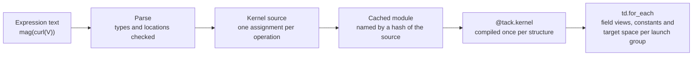

# Field Expressions for Tack

Jeff Lee, Kitware. This is the design document for `tack-expr`; [GUIDE.md](GUIDE.md) is the
shorter usage guide.

## Benefits

Field expressions let a Tack user compute a derived quantity, such as a vorticity magnitude, a net
face flux or a nondimensional temperature, by typing a VTK calculator expression over
`tack.dataset` fields. The expression compiles to a single Tack kernel that reads the fields in
place and runs within 5% of a hand-written kernel, on point, cell, face and higher-order finite
element data.

- **Familiar syntax.** Expressions use the VTK and ParaView array calculator syntax. Every test
  expression that `vtkArrayCalculator` accepts gives the same result, so expressions move between
  ParaView and Tack unchanged.
- **Every location.** Point data, cell data, face fluxes, and `H1` and `L2` fields of any order, on
  structured and unstructured meshes, share one model: `tack.dataset`'s fields and spaces.
  Conversions between locations are explicit operators that give the same results as VTK's and
  `tack.dataset`'s filters.
- **Speed.** Over 64M cells on an NVIDIA GB10, an expression writing into an existing array ran at
  238 GB/s, within 5% of a hand-written kernel on the same arrays and about 87% of the GB10's
  273 GB/s peak memory bandwidth.
- **Memory.** Fields are read from the solver's arrays without copies. Intermediate values stay in
  registers. The only allocation is the output, and a caller can supply that.
- **Exact gradients.** `grad()` differentiates a field through its basis and the geometry's
  Jacobian, so it is exact for fields of any order and for curved cells.
- **Small and native.** The compiler is about 2,000 lines of Python in its own package,
  `tack-expr`. The generated kernel is ordinary Tack source run by `td.for_each` on any Tack
  backend. Everything except the vector spaces and contours of expressions runs on Tack as it is.
- **Few recompiles.** Constants are kernel arguments. Editing `2.5` to `7.0` reuses the compiled
  kernel.

## Value for Tack

Field expressions give Tack an end-user layer: a way to compute derived quantities on any
`tack.dataset` field without writing a kernel. Kernel authors, who write solvers and new filters,
keep writing Python with `world_gradient` and the views. Application users, agents and
configuration (steering, Catalyst scripts, the trame box, notebooks) write expressions.

**One expression works on every function space.** A derived quantity's kernel spends most of its
code on reading its inputs: vector components split into scalars for `world_gradient`, launch
groups and domain views, a different loop for each output location (cells, points, the nodes of an
`L2` or `H1` space, tensor and lattice variants), point links to average cell data at points. Here
is `mag(curl(V))` at cell centers written that way:

```python
@tack.kernel
def split(values, k, out, n):
    for i in range(n):
        out[i] = values[i][k]

@tack.kernel
def vorticity(cells, ux, uy, uz, out):
    for c in cells:
        pc = cells.parametric_center()
        gx = td.world_gradient(cells, ux, c, pc)
        gy = td.world_gradient(cells, uy, c, pc)
        gz = td.world_gradient(cells, uz, c, pc)
        w = tack.vec3(gz[1] - gy[2], gx[2] - gz[0], gy[0] - gx[1])
        out[cells.entity_id(c)] = w.norm()

V = data.fields["V"]
parts = []
for k in range(3):
    a = tack.empty((V.space.size,), data.dtype)
    split(V.values, k, a, V.space.size)
    parts.append(td.Field(V.space, a))
out = tack.empty((data.num_cells,), data.dtype)
for group in data.launch_groups("cells", parts):
    if group.count:
        vorticity(data.domain_view("cells", group), *(p.view(group) for p in parts), out)
```

As an expression it is `fx.evaluate("mag(curl(V))", data)`, and the same text runs at nodes, on
point data, cell data, DG fields of any order, polyhedra, `HDiv` and `HCurl` fields, and
partitioned data. The compiler writes the loops above and picks them from the spaces involved; it
also takes exact first and second derivatives of whole expressions, which hand-written kernels
rarely do.

**A safe interface for agents and steering.** An expression is text in a small language: it is
checked before anything runs, it cannot execute arbitrary code, no user text reaches the generated
source, and an error names its column. That is what lets the CFD assistant add helicity to a
running solver and report a bad request back in words. For agent-driven analysis, at SC26 and
after, this is the most visible value.

**Derived fields in situ at little cost.** Expressions at one location fuse into one kernel, within
a few percent of hand-written code and three times faster than one kernel per operation; four
derived fields cost `tack-lbm` about 0.2% of its run.

**Pieces worth having in Tack on their own.** `HDiv` and `HCurl`, the public `world_gradient` and
`H1` node queries, and contouring fields evaluated on demand are useful to any `tack.dataset` user,
with or without expressions.

**What it costs.** `tack-expr` is a second compiler, about 2,000 lines plus tests, that generates
code against `tack.dataset`'s views; changes to those views would reach it. Its language is
deliberately small (no loops, matrices or user functions), and second-derivative kernels take
seconds to compile the first time.

**Packaging.** `tack-expr` is a package of its own and runs on Tack as it is, with two exceptions
that need the Tack branch: the vector spaces, and contours of expressions (shared points for
continuous expressions, and subdivision for higher orders), which rest on about ten lines in
`contour` and `subdivide`. Everything else on the branch is additive. So it can ship separately
unless Tack wants it in core, and the question for Tack's maintainers is how far Tack means to
reach toward end users: as a developer toolkit, expressions are a convenience; under
ParaView-style tools, Catalyst and agents, they are a core layer.

A Python front end to the same compiler is a small addition if users want Python's syntax: fields
as symbolic objects, so `mag(curl(V))` is an ordinary Python call that builds the expression.
Agents would still send strings, which can be checked and cannot run code.

## Overview

A parser reads the expression, checks each operation's scalar and vector types and where each
field can be read, and writes a Tack kernel with one assignment per operation. The source goes into
a module file in a cache directory, keyed by a hash of the source, and is imported. `@tack.kernel`
compiles it like any other kernel, and `td.for_each` runs it over the mesh.

```python
import tack.dataset as td
import tack_expr as fx

# data is any td.DataSet; fields are looked up by name in data.fields
speed_t = fx.evaluate("mag(V) * T", data, at="points")
outflow = fx.evaluate("fsum(flux)", data, at="cells")
detail = fx.evaluate("mag(grad(u)) * u", data, at=td.L2(data, order=2))
```

Each call returns a `td.Field` in the output's space. `fx.compile_expression` returns the compiled
kernel, to run repeatedly and optionally into an existing array. The kernel generated for the last
expression:

```python
@tack.kernel
def fx(dom, A0, target, out):
    for c in dom:
        for n in range((target.ORDER + 1) ** dom.DIMENSION):
            pc = target.node_parametric(n)
            a0 = _world_gradient(dom, A0, c, pc)
            t1 = a0.norm()
            a1 = A0.value(c, pc)
            t3 = t1 * a1
            out[target.dof_index(c, n)] = t3
```

`u` is an order-2 `H1` field. The kernel evaluates it and its gradient through its basis at each
node of the target space, the same way `td.project` and `td.gradients` do. Field values, constants
and the target space arrive as kernel arguments, and field names never appear in the source, so no
text the user typed reaches the source file.

**Output location.** `at` is `"cells"` (one value per cell, at its parametric center), `"points"`
(one value per point), `"faces"` (one value per face) or a space: `L2` of any order (one value per
node of each cell), or `H1` for an expression of continuous fields. It sets the output's space and
the loop the kernel runs. Fields at other locations are read as described under Locations and
function spaces.

## Syntax

The syntax is the pointwise part of the VTK array calculator syntax, as accepted by
`vtkArrayCalculator` with its default ExprTk parser. Every value is a scalar or a 3-vector.

| Form | Meaning |
| --- | --- |
| `T`, `"Field Name"` | a field; quotes allow any name |
| `V_X`, `V_Y`, `V_Z` | a component of vector field `V` |
| `coords`, `coordsX`, `coordsY`, `coordsZ` | position of the output point, cell center or node |
| `iHat`, `jHat`, `kHat`, `pi` | unit vectors, pi |
| `+ - * /` | arithmetic; a scalar with a vector applies to each component, two vectors act per component |
| `^`, `%` | power (right-associative), remainder with the sign of the dividend |
| `< <= > >= == = != <>` | comparisons, giving 1 or 0 |
| `and or not`, `& \|` | logic |
| `c ? a : b`, `if(c, a, b)` | selection, evaluated without branching |
| `abs acos asin atan ceil cos cosh exp floor ln log log10 sign sgn sin sinh sqrt tan tanh` | scalar functions |
| `min max pow atan2 clamp(lo, x, hi)` | scalar functions of several arguments |
| `mag(v) norm(v) dot(u, v) cross(u, v)` | magnitude, unit vector, products |
| `{a, b, c}`, `v[k]` | build a vector, read a component |

Extensions beyond the VTK calculator:

- `grad(u)`: the physical gradient of a scalar field with a basis, through its parametric gradient
  and the geometry's Jacobian.
- `div(V)`, `curl(V)`, `qcrit(V)`: divergence, vorticity and the Q-criterion of a vector field with
  a basis, as `td.flow_quantities` computes them, in one kernel.
- `grad()` and the others of an expression, such as `grad(T * P)`: the kernel carries each value's
  derivative (a gradient for a scalar, a Jacobian for a vector) and applies the chain rule, so the
  result is exact.
- `points(T)`, `cells(T)`: point or cell values, computed as VTK's `vtkCellDataToPointData` and
  `vtkPointDataToCellData` compute them.
- `owner(T)`, `neighbor(T)`: in a face expression, the cell value on side 0 or side 1 of the face.
  On a boundary face both give the one adjacent cell.
- `fsum(F)`: in a cell expression, the outward sum of a face field over the cell's faces, positive
  where the cell is on the face's side 0.
- `laplacian(u)` and nested derivatives: `div(grad(u))`, `grad(grad(u)[0])`, `curl(curl(U))`, also
  of expressions such as `laplacian(u * v)`. Each scalar carries its Hessian; a field's comes from
  its world gradient differentiated along the parametric axes with a fourth-order stencil, exact
  for fields up to order 4 on cells that map affinely.
- `mag2(v)`: squared magnitude.
- `&&`, `||`, `!`: accepted as synonyms for `and`, `or`, `not`. The VTK calculator rejects them.
- `replace_invalid=`: a value that replaces NaN and infinite results, as `vtkArrayCalculator`'s
  ReplaceInvalidValues does.

Not supported: ExprTk's statements, loops, assignments and strings. These are outside what the VTK
calculator documents.

## Locations and function spaces

Every field is a `tack.dataset` field: values in a space on the mesh's topology. The space says
where the values live and how to evaluate between them, so finite volume, finite element and
cell-grid data share one model.

| Simulation data | Space | Values live on |
| --- | --- | --- |
| Finite volume cell values | `Constant` | cells |
| Face fluxes, face areas, boundary face values | `Values(on="faces")`, `oriented=True` for normal fluxes | faces |
| Edge data | `Values(on="edges")` | edges |
| Point data | `H1`, order 1 | points |
| Continuous finite element fields, cell-grid HGRAD attributes | `H1`, order p, Lagrange or Bernstein, element-to-DOF table | points, edges, faces, cell interiors |
| Discontinuous Galerkin fields | `L2`, order p | each cell's own nodes |
| Values from both sides of each face | `SideTraces` | faces, per side |

**Evaluation.** An expression has an output: one value per entity of a set (points, edges, faces
or cells), or a target space. The generated kernel runs over the output with `td.for_each`, and
each field is read through its view. A field on the same entities is read by index. A field with a
basis is evaluated at the output's parametric coordinate, `u.value(c, pc)`, which is the target
space's node or the cell's center. Evaluating a field's basis inside its own cell is how the field
is defined, so it needs no conversion operator.

**Conversions.** Moving data between entity sets is explicit: `points()`, `cells()`, `owner()`,
`neighbor()` and `fsum()`, all inside the kernel. `cells(T)` averages each cell's corner values.
`points(T)` of cell data averages the cells around each point: by index arithmetic on structured
grids, through the point links on unstructured meshes of one cell shape or several, and through
the cells' point lists on polyhedra. Both give VTK's results to float32 rounding.

**Gradients.** `grad(u)` uses the field's parametric gradient and the cell's geometry Jacobian,
through the same function `tack.dataset`'s gradients filter uses. It is exact for any order and for
curved cells. A gradient at points needs averaging over the cells around each point, so `grad()` is
refused in a point expression and `td.gradients(at="points")` gives that average.

**Nonlinear operations on higher-order fields.** Linear operations on fields in one space could act
on coefficients; `sqrt`, `mag` and products cannot. The expression is evaluated at points. A result
stored as a field is its interpolant at the target space's nodes, which is how `project()` fills a
nodal space. A target order at least the inputs' order keeps the error small; representing a
product exactly needs a higher order. A Bernstein target (VTK's Bezier cells) needs the node values
converted to coefficients. A true L2 projection needs a mass-matrix solve and stays with MFEM or a
separate filter.

**Vector spaces.** The Tack branch adds `HDiv` (Raviart-Thomas) and `HCurl` (Nedelec, first kind):
at order 1 on hexahedra, voxels and tetrahedra, and of any order on hexahedra and voxels. Above
order 1 their values on shared faces and edges are kept in the face's or edge's own frame, so cells
that number their corners differently read them alike; a test on hexahedra numbered from random
rotations of the cube checks this. Field expressions read them as world vectors through the Piola
maps, `div()` of an `HDiv` field through `td.hdiv_div` and `curl()` of an `HCurl` field through
`td.hcurl_curl`.

**Expressions without storing them.** `fx.field(text, data)` is a `td.Field` computed wherever an
algorithm reads it, and `fx.contour` contours an expression with nothing stored: each crossing is
the expression's own root, and an expression of continuous fields gives a watertight surface. This
needed two small Tack changes, spaces that declare themselves `evaluated` or `continuous`.

**Pieces and continuity.** `evaluate(update_ghosts=True)` refreshes the ghost values of the fields
an expression reads, through `td.update_ghosts`, so chained evaluations on pieces stay right on the
ghost layer. `project=True` evaluates an expression of discontinuous fields into `L2` and averages
it into `H1`.

## How it works



The kernel source depends on the expression's structure, the output location and how each field
is read. When that combination was already compiled in the same process, only the parser runs and
the compiled kernel is reused. The dataset supplies the field views, constants and target space at
each call, and `td.for_each` launches the kernel once per cell shape, so the same source serves any
mesh.

## Compatibility with VTK

All 21 checks passed on both the CUDA and CPU backends, covering the calculator syntax,
conversions, unstructured meshes, higher-order fields and face operators. Differences come from
evaluating in float32 where VTK evaluates in double; the largest was 2.3e-6, for `mag(grad(u))` on
order-2 nodes.

| Check | Compared against | Largest relative difference |
| --- | --- | --- |
| 57 calculator expressions on point data of an unstructured mesh of 2,394 voxels | `vtkArrayCalculator` | below 1e-4, all 57 |
| 4 expressions on cell data | `vtkArrayCalculator`, cell attribute type | 1.2e-7 |
| `cells(T)`, and `T` at cells through its basis | `vtkPointDataToCellData` | 1.2e-7 |
| `points(T)`, `points(V) * 2` | `vtkCellDataToPointData` | 2.1e-7 |
| `T * 2 + P` at points and `cells(T)` on 11,970 tetrahedra | `vtkArrayCalculator`, `vtkPointDataToCellData` | 6.0e-8 |
| `grad(T)` on tetrahedra | `td.gradients` | 0 |
| Order-2 `H1` field `u = x^2 + y z` at `L2` order-2 nodes | `td.project` | 0 |
| `u * u + 2`, `grad(u)`, `mag(grad(u))` | exact values; `td.gradients` | 2.3e-6; 0 |
| `fsum(flux)` for the flux of `v = (x, y, z)` | `td.net_flux`; divergence 3 | 0; 7.9e-8 |
| `neighbor(TC) - owner(TC)`, `flux * owner(TC)` at faces | the faces' side cells | 0 |

An earlier version on plain arrays ran a wider set of 64 calculator expressions, including `log`,
`sgn`, `==` and `!=`, and matched VTK on all of them; the current version shares its parser.

An expression that reads a field at the wrong location is refused, with the fix in the message. For
example, `flux * 2` in a cell expression gives "'flux' is on faces, the expression is on cells; use
fsum(flux)", and `TC + 1` in a point expression gives "'TC' is not continuous; use points(TC) for
point values".

A second test, `test_more.py`, covers what was added after the first: 33 checks, all passing on
CUDA and CPU.

| Check | Compared against | Largest relative difference |
| --- | --- | --- |
| `div(U)`, `curl(U)`, `qcrit(U)` of an order-2 vector field | `td.flow_quantities`; exact divergence | 0; 3.6e-7 |
| `grad(2 * u + 1)`, staged through an `L2` field | 2 x `td.gradients(u)` | 1.2e-6 |
| `cells(T)` and `points(T)` inside the kernel | VTK's conversion filters | 2.1e-7 |
| A user kernel calling the expression through `fx.function` | `evaluate` | 0 |
| Node output: `L2` order 1 and 2 on tetrahedra, `H1` order 2 on voxels and tetrahedra | `td.project`, the fields' own values | 0 |
| Point and cell data, `cells()` and `fsum()` on polyhedral cells | `vtkArrayCalculator`, VTK filters, `td.net_flux` | 1.2e-7 |
| A float64 expression | `vtkArrayCalculator` in double | 0 |
| `ln(T - 0.5)` with invalid values replaced by -1 | `vtkArrayCalculator` with ReplaceInvalidValues | 7.6e-8 |
| A compiled expression reused after the solver replaces or updates its arrays | `td.flow_quantities`, `td.project` | 0 |
| Five expressions on 4 pieces with a ghost layer: owned mean, min, max and count | the unsplit mesh | 1.6e-7 |
| `HDiv` and `HCurl` fields of linear and constant vectors; `div()` of the `HDiv` field | exact values | 2.9e-7 |

On the Tack branch, the new spaces' tests pass on CPU and CUDA, and Tack's full tack-vis suite
gives 3,606 passed and 664 skipped. Its one failure, `test_vtk_char_arrays_come_across_as_i8`,
fails on main as well.

Later tests cover the second and third rounds of work, all passing on CUDA and CPU:

| Test | Checks | Compared against | Largest difference |
| --- | --- | --- | --- |
| `test_derivatives.py` | 16 expressions' `grad`, `div`, `curl` and `qcrit` at cells and at order-2 nodes | float64 central differences of the exact fields | 6e-7 at cells, 3.5e-6 at nodes |
| `test_second.py` | 11 second-derivative expressions at cells and nodes, in float32 and float64 | float64 central differences of the exact fields | 2e-4 in float32, 1e-13 in float64 |
| `test_many.py` | 10 expressions compiled three or five to a kernel | each expression's own kernel | 0 |
| `test_points.py` | `points()` on uniform, 2D, rectilinear, renumbered, mixed and polyhedral meshes, with no `td.project` call | `td.project`, `vtkCellDataToPointData` | 0; 1.2e-7 |
| `test_ghosts.py` | a chain of four evaluations on pieces, with and without the ghost refresh; projection into `H1`; cache cleanup | the unsplit mesh; `td.project` | 1e-7 with the refresh, 1.6e-3 without |
| `test_contour.py` | contours of expression fields, linear and order 2, with derivatives | contours of stored fields; the exact level | identical; 1.3e-7 from the level |
| Tack's `test_vector_spaces.py` | `HDiv` and `HCurl` on hexahedra, tetrahedra, orders 1 to 3, and on hexahedra numbered from random rotations | the fields of each space | 2e-5 |

The tests are the `test_*.py` scripts in `packages/tack-expr`, each run as
`python test_more.py cuda` (or `cpu`); they print each check and a count.

## Performance

`sqrt(A*A + 2.5*B)` on two cell fields of a 400 x 400 x 400 uniform grid (64M cells) took 3.22 ms
on an NVIDIA GB10 (CUDA backend), writing into an existing array. That is 238 GB/s counting two
4-byte reads and one 4-byte write per cell, about 87% of the GB10's 273 GB/s peak memory
bandwidth.

| Method, 64M float32 cell values | Time (ms) | Effective bandwidth, 12 bytes per cell (GB/s) |
| --- | --- | --- |
| Field expression, into an existing array | 3.22 | 238 |
| Field expression, allocating its output | 4.39 | 175 |
| Hand-written kernel on the same flat arrays | 3.08 | 249 |
| Tack, one kernel per operation with temporary arrays | 9.10 | 84 |
| NumPy, single CPU thread with temporary arrays | 65.9 | 12 |

Times are medians of 20 runs after a warm-up call, synchronized with `tack.sync()`, and results
matched NumPy exactly. The last two rows were measured earlier on flat arrays of the same size.
Allocating a 256 MB output on every call adds 1.2 ms, so a solver loop passes its own array.

At 16M cells the expression took 0.90 ms against 0.78 ms for the hand-written kernel. At 1M cells
it took 0.088 ms against 0.022 ms: about 65 microseconds per call goes to `td.for_each`'s launch
setup, which matters only for small meshes or many small expressions.

The first evaluation of an expression with a new structure took 80 ms on a 50 x 50 x 50 grid,
including parsing and Tack's compile. The same expression in a new process took 14 ms, with the
generated-module cache empty or full, so Tack's disk cache spares later processes the compile.
Changing only a constant took 0.3 ms. Derivatives of expressions compile more slowly, because the
kernel carries 3 x 3 Jacobians: 0.56 s for `grad(u * v)` and 1.3 s for `qcrit(U * v + 3 * coords)`
on CUDA, about half that on the CPU.

Two changes cut the time per evaluation. `fx.compile_many` compiles several expressions at one
location into one kernel, so four derived fields of a velocity field on a 192 x 64 x 32 grid take
0.20 ms rather than 0.62 ms. `points()` of cell data averages inside the kernel on every mesh:
0.03 ms on the same grid, against 0.39 ms for `td.project` and a second kernel.

## Integrations

Three branches use field expressions in running code.

**tack-lbm, branch `field-expressions`.** The Catalyst grid channel carries `vorticity`
(`mag(curl(velocity))`) and `q_criterion` (`qcrit(velocity)`) as element fields, evaluated on the
output grid at each Catalyst call. `--derive NAME=EXPRESSION[@cells]` adds more, and so can a Live
client while the solver runs: a second steering proxy, `LBMDerived`, takes the text, the solver
compiles it at the next Catalyst call, and the `derived_error` monitor gives the column of an
error. The expressions at each location share one kernel. On a 128 x 64 x 32 grid, both default
fields match `td.gradients` with `td.flow_quantities` to 7e-8 and an independent NumPy cell-center
difference to 3e-6; four fields take 0.44 ms per Catalyst call, and at the default size 0.50 ms
against 2.59 ms per solver step.

**trame-cfd-mcp, branch `field-expressions`.** A steering property marked as text is reported and
set as text, so the CFD assistant can add a field such as helicity in conversation. Driven through
the assistant's own tools, a request for
`helicity=dot(velocity, curl(velocity))@cells; cp=2 * pressure / 0.0064` put both fields on the
live grid channel within a Catalyst call, and a bad expression came back as an error while the
previous fields stayed.

**tack-demos, branch `field-expressions`.** The sidebar takes an expression and colors the image,
isosurface or tubes by it. An expression with gradients is evaluated at cell centers and averaged
to the points for display, and the app says so under the box. "Show kernel" includes the generated
kernel, and errors show their column. Every demo's colored values match NumPy, and the app's apply
handler was exercised headlessly with renders checked by eye.

## Limitations and open questions

- **Vector spaces above order 1 on simplices.** `HDiv` and `HCurl` above order 1 are on hexahedra
  and voxels; tetrahedra have order 1, and wedges and pyramids neither. Derivatives of `HDiv` and
  `HCurl` fields inside a larger expression are refused.
- **Third derivatives.** `grad(laplacian(u))` and `qcrit()` inside a derivative are refused.
- **Second derivatives compile slowly and round.** A kernel with Hessians takes about 1 second to
  compile at order 1 and 12 seconds at order 3, once; in float32 the stencil leaves about 1e-4 of
  the largest value as rounding (1e-13 in float64). On curved cells it is fourth-order accurate,
  not exact.
- **A subdivided contour of an expression refines every cell.** An expression has no Bernstein
  bound to skip cells by, as a stored field does.
- **Ghost exchange across MPI ranks is untested here.** `update_ghosts=True` uses Tack's exchange,
  tested in one process; `mpi4py` is not installed on the Spark.
- **Steering status is per request.** The `derived_status` channel holds the outcome of the last
  steering request only.
- **Host overhead per call.** About 65 microseconds per launch goes to `td.for_each`'s setup;
  `compile_many` shares one launch among several expressions.
- **Metal.** Tack's Metal backend has no float64, so float64 expressions run on the other backends
  only.

## Plan

Everything in this document is implemented and tested on the Spark. The Tack branch, with
`tack-expr` in it as `packages/tack-expr`, is on the public fork
[jlee-kitware/tack](https://github.com/jlee-kitware/tack/tree/field-expression-support), so changes
to Tack core can be discussed before any pull request. The other branches are local.

| Repository | Where | What |
| --- | --- | --- |
| tack | `field-expression-support` on jlee-kitware/tack | public `world_gradient` and `H1` node queries; `HDiv` and `HCurl`; contour of evaluated and continuous spaces; tests, reference entries and changelog fragments |
| tack-expr | `packages/tack-expr` on the same branch, a package of its own | the compiler, first and second derivatives, `compile_many`, expression fields and contours, ghost refresh; nine test scripts and this document as its README |
| tack-lbm | branch `field-expressions`, local | derived fields in the Catalyst grid channel, one kernel per location, steerable from a Live client with a status channel |
| trame-cfd-mcp | branch `field-expressions`, local | text steering parameters and their outcome for the CFD assistant |
| tack-demos | branch `field-expressions`, local | the expression box on every demo, particles included |

The next steps:

1. **Review the Tack branch with its maintainers.** It adds public functions, two spaces, and two
   attributes a space can declare to `contour`.
2. **Vector spaces above order 1 on tetrahedra**, with face and interior moments in barycentric
   bases.
3. **Bounds for expression fields**, so a subdivided contour skips cells whose expression cannot
   reach the level, from interval bounds on its inputs.
4. **Every rank in the ghost exchange.** A rank that owns no pieces skips the `td.update_ghosts`
   call that `update_ghosts=True` makes, because it names the fields from a local piece; naming
   them from the dataset's field names would keep every rank in the exchange. Tack tests the
   exchange itself across ranks.

