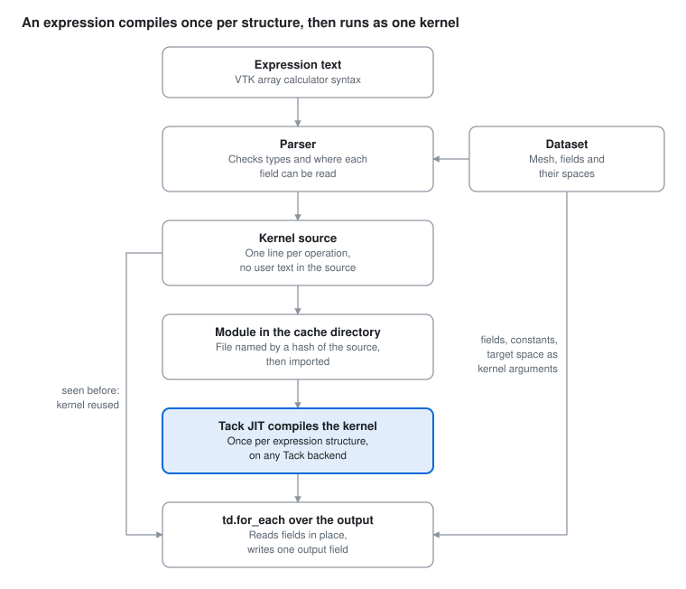

# Field Expressions for Tack

Jeff Lee, Kitware. This is the design document for `tack-expr`; [GUIDE.md](GUIDE.md) is the shorter
usage guide.

## Benefits

Field expressions let a Tack user compute a derived quantity, such as a vorticity magnitude, a net
face flux or a nondimensional temperature, by typing a VTK calculator expression over `tack.dataset`
fields. The expression compiles to a single Tack kernel that reads the fields in place and runs
within 5% of a hand-written kernel, on point, cell, face and higher-order finite element data.

- **Familiar syntax.** Expressions use the VTK and ParaView array calculator syntax. Every test
  expression that `vtkArrayCalculator` accepts gives the same result, so expressions move between
  ParaView and Tack unchanged.
- **Every location.** Point data, cell data, face fluxes, and `H1` and `L2` fields of any order, on
  structured and unstructured meshes, share one model: `tack.dataset`'s fields and spaces.
  Conversions between locations are explicit operators that give the same results as VTK's and
  `tack.dataset`'s filters.
- **Speed.** Over 64M cells on an NVIDIA GB10, an expression writing into an existing array ran at
  238 GB/s, within 5% of a hand-written kernel on the same arrays and about 87% of the GB10's 273
  GB/s peak memory bandwidth.
- **Memory.** Fields are read from the solver's arrays without copies. Intermediate values stay in
  registers. The only allocation is the output, and a caller can supply that.
- **Exact gradients.** `grad()` differentiates a field through its basis and the geometry's
  Jacobian, so it is exact for fields of any order and for curved cells.
- **Small and native.** The compiler is about 4,400 lines of Python in its own package, `tack-expr`.
  The generated kernel is ordinary Tack source run by `td.for_each` on any Tack backend. Everything
  except contours of expressions runs on Tack's main as it is.
- **Few recompiles.** Constants are kernel arguments. Editing `2.5` to `7.0` reuses the compiled
  kernel.

## Value for Tack

Field expressions give Tack an end-user layer: a way to compute derived quantities on any
`tack.dataset` field without writing a kernel. Kernel authors, who write solvers and new filters,
keep writing Python with `world_gradient` and the views. Application users, agents and configuration
(steering, Catalyst scripts, trame apps, notebooks) write expressions.

**One expression works on every function space.** A derived quantity's kernel spends most of its
code on reading its inputs: vector components split into scalars for `world_gradient`, launch groups
and domain views, a different loop for each output location (cells, points, the nodes of an `L2` or
`H1` space, tensor and lattice variants), point links to average cell data at points. Here is
`mag(curl(V))` at cell centers written that way:

```python
@tack.kernel
def split(values, k, out, n):
    for i in range(n):
        out[i] = values[i][k]

@tack.kernel
def vorticity(cells, ux, uy, uz, out):
    for c in cells:
        pc = cells.parametric_center()
        gx = td.world_gradient(cells, ux, c, pc)
        gy = td.world_gradient(cells, uy, c, pc)
        gz = td.world_gradient(cells, uz, c, pc)
        w = tack.vec3(gz[1] - gy[2], gx[2] - gz[0], gy[0] - gx[1])
        out[cells.entity_id(c)] = w.norm()

V = data.fields["V"]
parts = []
for k in range(3):
    a = tack.empty((V.space.size,), data.dtype)
    split(V.values, k, a, V.space.size)
    parts.append(td.Field(V.space, a))
out = tack.empty((data.num_cells,), data.dtype)
for group in data.launch_groups("cells", parts):
    if group.count:
        vorticity(data.domain_view("cells", group), *(p.view(group) for p in parts), out)
```

As an expression it is `fx.evaluate("mag(curl(V))", data)`, and the same text runs at nodes, on
point data, cell data, DG fields of any order, polyhedra, `HDiv` and `HCurl` fields, and partitioned
data. The compiler writes the loops above and picks them from the spaces involved; it also takes
exact first and second derivatives of whole expressions, which hand-written kernels rarely do.

**A safe interface for agents and steering.** An expression is text in a small language: it is
checked before anything runs, it cannot execute arbitrary code, no user text reaches the generated
source, and an error names its column. That lets an assistant add a field such as helicity to a
running solver through Catalyst steering, and report a bad request back in words. For agent-driven
analysis, at SC26 and after, this is the most visible value.

**Derived fields in situ at little cost.** Expressions at one location fuse into one kernel, within
a few percent of hand-written code and three times faster than one kernel per operation; four
derived fields cost a lattice Boltzmann solver about 0.2% of its run.

**Pieces now in Tack.** `HDiv` and `HCurl`, the public `world_gradient`, `world_hessian` and
`world_jet`, and the code generator's linear-time typing came out of this work and are in Tack's
main, useful to any `tack.dataset` user with or without expressions.

**What it costs.** `tack-expr` is a second compiler, about 4,400 lines plus tests, that generates
code against `tack.dataset`'s views; changes to those views would reach it. Its language is
deliberately small, with no loops, statements or user functions. A kernel with second derivatives
compiles once, in 0.6 s at order 3 and up to about 5 s for large expressions.

**Packaging.** `tack-expr` is a package of its own and runs on Tack's main, with one exception:
contours of expressions (shared points for continuous expressions, and subdivision for higher
orders) rest on about ten lines in `contour` and `subdivide`, which come with tack-expr's pull
request. So it can ship separately unless Tack wants it in core, and the question for Tack's
maintainers is how far Tack means to reach toward end users: as a developer toolkit, expressions are
a convenience; under ParaView-style tools, Catalyst and agents, they are a core layer.

The same compiler takes expressions written with Python operators on `td.Field`s, `(U + V /
fx.curl(W)).eval(data)`, described under Python operators. Units, the field dictionary and complex
values work the same way from Python. Agents still send strings, which can be checked and cannot run
code.

## Overview

A parser reads the expression, checks each operation's scalar and vector types and where each field
can be read, and writes a Tack kernel with one assignment per operation. The source goes into a
module file in a cache directory, keyed by a hash of the source, and is imported. `@tack.kernel`
compiles it like any other kernel, and `td.for_each` runs it over the mesh.

```python
import tack.dataset as td
import tack_expr as fx

# data is any td.DataSet; fields are looked up by name in data.fields
speed_t = fx.evaluate("mag(V) * T", data, at="points")
outflow = fx.evaluate("fsum(flux)", data, at="cells")
detail = fx.evaluate("mag(grad(u)) * u", data, at=td.L2(data, order=2))
```

Each call returns a `td.Field` in the output's space. `fx.compile_expression` returns the compiled
kernel, to run repeatedly and optionally into an existing array. The kernel generated for the last
expression:

```python
@tack.kernel
def fx(dom, A0, target, out):
    for c in dom:
        for n in range((target.ORDER + 1) ** dom.DIMENSION):
            pc = target.node_parametric(n)
            a0 = _world_gradient(dom, A0, c, pc)
            t1 = a0.norm()
            a1 = A0.value(c, pc)
            t3 = t1 * a1
            out[target.dof_index(c, n)] = t3
```

`u` is an order-2 `H1` field. The kernel evaluates it and its gradient through its basis at each
node of the target space, the same way `td.project` and `td.gradients` do. Field values, constants
and the target space arrive as kernel arguments, and field names never appear in the source, so no
text the user typed reaches the source file.

**Output location.** `at` is `"cells"` (one value per cell, at its parametric center), `"points"`
(one value per point), `"faces"` (one value per face) or a space: `L2` of any order (one value per
node of each cell), or `H1` for an expression of continuous fields. It sets the output's space and
the loop the kernel runs. Fields at other locations are read as described under Locations and
function spaces.

## Syntax

The syntax is the pointwise part of the VTK array calculator syntax, as accepted by
`vtkArrayCalculator` with its default ExprTk parser. A value is a scalar, a 3-vector or a 3x3
tensor. Tensors, complex values, units and the field dictionary extend the calculator, and are
described under Engineering quantities.

| Form | Meaning |
| --- | --- |
| `T`, `"Field Name"` | a field; quotes allow any name |
| `V_X`, `V_Y`, `V_Z` | a component of vector field `V` |
| `coords`, `coordsX`, `coordsY`, `coordsZ` | position of the output point, cell center or node |
| `iHat`, `jHat`, `kHat`, `pi` | unit vectors, pi |
| `+ - * /` | arithmetic; a scalar with a vector applies to each component, two vectors act per component |
| `^`, `%` | power (right-associative), remainder with the sign of the dividend |
| `< <= > >= == = != <>` | comparisons, giving 1 or 0 |
| `and or not`, `& \|` | logic |
| `c ? a : b`, `if(c, a, b)` | selection, evaluated without branching |
| `abs acos asin atan ceil cos cosh exp floor ln log log10 sign sgn sin sinh sqrt tan tanh` | scalar functions |
| `min max pow atan2 clamp(lo, x, hi)` | scalar functions of several arguments |
| `mag(v) norm(v) dot(u, v) cross(u, v)` | magnitude, unit vector, products |
| `{a, b, c}`, `v[k]` | build a vector, read a component |

Extensions beyond the VTK calculator:

- `grad(u)`: the physical gradient of a scalar field with a basis, through its parametric gradient
  and the geometry's Jacobian.
- `div(V)`, `curl(V)`, `qcrit(V)`: divergence, vorticity and the Q-criterion of a vector field with
  a basis, as `td.flow_quantities` computes them, in one kernel.
- `grad()` and the others of an expression, such as `grad(T * P)`: the kernel carries each value's
  derivative (a gradient for a scalar, a Jacobian for a vector) and applies the chain rule, so the
  result is exact.
- `points(T)`, `cells(T)`: point or cell values, computed as VTK's `vtkCellDataToPointData` and
  `vtkPointDataToCellData` compute them.
- `owner(T)`, `neighbor(T)`: in a face expression, the cell value on side 0 or side 1 of the face.
  On a boundary face both give the one adjacent cell.
- `fsum(F)`: in a cell expression, the outward sum of a face field over the cell's faces, positive
  where the cell is on the face's side 0.
- `laplacian(u)` and nested derivatives: `div(grad(u))`, `grad(grad(u)[0])`, `curl(curl(U))`, also
  of expressions such as `laplacian(u * v)`. Each scalar carries its Hessian; a field's is read with
  its value and gradient in one pass over its degrees of freedom, exact on curved cells.
- `mag2(v)`: squared magnitude.
- `&&`, `||`, `!`: accepted as synonyms for `and`, `or`, `not`. The VTK calculator rejects them.
- `replace_invalid=`: a value that replaces NaN and infinite results, as `vtkArrayCalculator`'s
  ReplaceInvalidValues does.

Not supported: ExprTk's statements, loops, assignments and strings. These are outside what the VTK
calculator documents.

## Python operators

The same expressions can be written with Python operators on `td.Field`s, the form Berk Geveci
proposed:

```python
U, V, W, T = (data.fields[n] for n in ("U", "V", "W", "T"))
(U + V / fx.curl(W)).eval(data)                      # at cell centers
fx.mag(U).eval(data, at="points")
q = fx.qcrit(U).compile(data)                        # call q(data) as often as U changes
(np.sin(T) * 2 + fx.where(T > 0.5, T, 0)).contour(data, 1.0)
```

An expression is a tree of operations on the functions its fields represent. A `td.Field` in it is
that field; `fx.ref("T")` is a name, bound to whatever field the dataset holds when the expression
runs, which is what partitioned data needs. Evaluating binds the names to fields, and compiling
picks how each field is read from its space and the output location. The tree is written in the
calculator syntax and compiled as text is, so derivatives, conversions and `compile_many` work the
same way. NumPy's ufuncs and the calculator's functions make expressions; `==`, `and` and `or` stay
Python's, and `&`, `|`, `~` and `fx.where` take their place.

## Engineering quantities

Tensors, complex values, units, and names that map to a solver's storage come up in nearly every
engineering expression. Tensors are in the code generator. The other three are passes over the
expression's tree before code generation, shared by text and the Python operators, and an expression
that needs none of them compiles to the kernel it always did.

```python
names = fx.cgns().with_units(Pressure="psi")
fx.evaluate("Pressure - 101.325[kPa]", data, fields=names, units="kPa")
fx.evaluate("eigvals(sym(grad(U)))[0]", data)                  # largest principal strain rate
fx.evaluate("vonmises(phase(sigma, 45[deg]))", data, fields=harmonic, units="MPa")
```

**Tensors.** A field stored as `tack.mat3`, or as 9 components or 6 symmetric ones in VTK's order
(XX YY ZZ XY YZ XZ), is a 3x3 tensor. `grad()` of a vector is its Jacobian, `{u, v, w}` of three
vectors is the tensor with those rows, and `identity` is the unit tensor. `trace`, `det`,
`transpose`, `inv`, `sym`, `skew`, `dev`, `ddot`, `outer`, `vonmises`, `eigvals` (principal values,
largest first) and `mag` take tensors, and `dot` multiplies tensors and vectors in any order. `S[i]`
is a row and `S_XY` an entry. `div()` of a tensor field or tensor expression is the vector of its
rows' divergences, and `laplacian()` of a vector is the vector of its components' Laplacians, so
`div(S) + f` is an equilibrium residual and the Lamé operator of a displacement is one expression.

**Complex values.** A harmonic analysis stores a complex field as two real ones, and `u_real` and
`u_imag` (or `_re` and `_im`) are read as `u`. Arithmetic, `exp`, the derivatives and the linear and
bilinear functions take complex values, and `real`, `imag`, `abs`, `arg`, `conj` and `phase(u,
angle)`, the response at a phase, end in real ones. The pass splits each complex value into its two
parts, so the kernel is of real fields. `fx.evaluate` refuses a result that is still complex, with
the choices in the message; `fx.evaluate_complex` returns it as two fields, its real and imaginary
parts, from one kernel.

**Units.** Units are Tack's own: `Field.unit`, `DataSet.unit` for the geometry, and
`tack.dataset.units`, on unyt. Known units that differ are converted where they meet, in a sum, a
comparison, `min`, `max` or a choice, and refused when their dimensions differ. A derivative divides
by the geometry's unit, and a derivative of degrees Celsius is in kelvin. An unknown unit is neither
guessed nor refused, and the result's unit is then unknown. `101.325[kPa]` writes a quantity, a bare
number in a sum is in the unit of what it meets, and `units="MPa"` converts the result. Conversions
are constant factors in the kernel, only where units meet, so kPa plus kPa stays kPa. Every entry
point takes a dictionary and `units=`: `evaluate`, `compile_expression`, `compile_many`, `fx.field`,
`fx.contour` and the Python operators, and the fields they make carry the result's unit.

**Field dictionary.** `fx.FieldDictionary` maps the names an expression uses to what a dataset
stores, and gives units to fields stored without one. An entry finds its storage by its name or an
alias, by three component fields as a vector or six as a symmetric tensor, by a real and an
imaginary part, or by an expression. `fx.cgns()` holds the CGNS SIDS flow quantities, and structural
and electromagnetic ones named in the same style, in SI. So `Pressure / (0.5 * Density *
mag2(Velocity))` runs on any solver output the dictionary can map, whatever the arrays are called
and whatever units they are stored in.

`test_expr_units.py` and `test_expr_tensors.py` check these against NumPy on the CPU and CUDA
backends. `examples/52_engineering_quantities.py` reads a harmonic response stored in mm and MPa, as
twelve stress arrays and two displacement arrays, through a dictionary, and gives its amplitude in
micrometres, the von Mises stress at three phases, and the principal stresses.

## Locations and function spaces

Every field is a `tack.dataset` field: values in a space on the mesh's topology. The space says
where the values live and how to evaluate between them, so finite volume, finite element and
cell-grid data share one model.

| Simulation data | Space | Values live on |
| --- | --- | --- |
| Finite volume cell values | `Constant` | cells |
| Face fluxes, face areas, boundary face values | `Values(on="faces")`, `oriented=True` for normal fluxes | faces |
| Edge data | `Values(on="edges")` | edges |
| Point data | `H1`, order 1 | points |
| Continuous finite element fields, cell-grid HGRAD attributes | `H1`, order p, Lagrange or Bernstein, element-to-DOF table | points, edges, faces, cell interiors |
| Discontinuous Galerkin fields | `L2`, order p | each cell's own nodes |
| Values from both sides of each face | `SideTraces` | faces, per side |

**Evaluation.** An expression has an output: one value per entity of a set (points, edges, faces or
cells), or a target space. The generated kernel runs over the output with `td.for_each`, and each
field is read through its view. A field on the same entities is read by index. A field with a basis
is evaluated at the output's parametric coordinate, `u.value(c, pc)`, which is the target space's
node or the cell's center. Evaluating a field's basis inside its own cell is how the field is
defined, so it needs no conversion operator.

**Conversions.** Moving data between entity sets is explicit: `points()`, `cells()`, `owner()`,
`neighbor()` and `fsum()`, all inside the kernel. `cells(T)` averages each cell's corner values.
`points(T)` of cell data averages the cells around each point: by index arithmetic on structured
grids, through the point links on unstructured meshes of one cell shape or several, and through the
cells' point lists on polyhedra. Both give VTK's results to float32 rounding.

**Gradients.** `grad(u)` uses the field's parametric gradient and the cell's geometry Jacobian,
through the same function `tack.dataset`'s gradients filter uses. It is exact for any order and for
curved cells. A gradient at points needs averaging over the cells around each point, so `grad()` is
refused in a point expression and `td.gradients(at="points")` gives that average.

**Nonlinear operations on higher-order fields.** Linear operations on fields in one space could act
on coefficients; `sqrt`, `mag` and products cannot. The expression is evaluated at points. A result
stored as a field is its interpolant at the target space's nodes, which is how `project()` fills a
nodal space. A target order at least the inputs' order keeps the error small; representing a product
exactly needs a higher order. A Bernstein target (VTK's Bezier cells) needs the node values
converted to coefficients. A true L2 projection needs a mass-matrix solve and stays with MFEM or a
separate filter.

**Vector spaces.** Tack has `HDiv` (Raviart-Thomas) and `HCurl` (Nedelec, first kind), from this
work: at order 1 on hexahedra, voxels and tetrahedra, and of any order on hexahedra and voxels.
Above order 1 their values on shared faces and edges are kept in the face's or edge's own frame, so
cells that number their corners differently read them alike. A test fills both with random values
and compares the two sides' normal or tangential components at points of every interior face, on
hexahedra numbered by all 48 symmetries of the cube (some inside out, which `HDiv` handles by
dividing by |det J|), non-affine hexahedra, voxels, and tetrahedra with permuted corners. Field
expressions read them as world vectors through the Piola maps, `div()` of an `HDiv` field through
`td.hdiv_div` and `curl()` of an `HCurl` field through `td.hcurl_curl`.

**Expressions without storing them.** `fx.field(text, data)` is a `td.Field` computed wherever an
algorithm reads it, and `fx.contour` contours an expression with nothing stored: each crossing is
the expression's own root, and an expression of continuous fields gives a watertight surface. This
needed two small Tack changes, spaces that declare themselves `evaluated` or `continuous`. An
expression field also bounds its values in each cell, by interval arithmetic over its inputs'
Bernstein bounds, so a subdivided contour refines only the cells whose bound holds the level.
Arithmetic, integer powers, comparisons, `if`, `min`, `max`, `clamp`, `abs`, `sqrt`, `log`, `exp`,
`tanh`, `atan`, `sinh`, `sin` and `cos` have rules; an expression with a derivative or another
function has no bound and refines every cell. `test_expr_bounds.py` checks each cell's bound against
the expression's values at order-4 nodes, and that a contour with bounds is the contour without
them, on CPU and CUDA.

**Pieces and continuity.** `evaluate(update_ghosts=True)` refreshes the ghost values of the fields
an expression reads, through `td.update_ghosts`, so chained evaluations on pieces stay right on the
ghost layer. `project=True` evaluates an expression of discontinuous fields into `L2` and averages
it into `H1`.

## How it works



The kernel source depends on the expression's structure, the output location and how each field is
read. When that combination was already compiled in the same process, only the parser runs and the
compiled kernel is reused. The dataset supplies the field views, constants and target space at each
call, and `td.for_each` launches the kernel once per cell shape, so the same source serves any mesh.

## Compatibility with VTK

All 21 checks passed on both the CUDA and CPU backends, covering the calculator syntax, conversions,
unstructured meshes, higher-order fields and face operators. Differences come from evaluating in
float32 where VTK evaluates in double; the largest was 2.3e-6, for `mag(grad(u))` on order-2 nodes.

| Check | Compared against | Largest relative difference |
| --- | --- | --- |
| 57 calculator expressions on point data of an unstructured mesh of 2,394 voxels | `vtkArrayCalculator` | below 1e-4, all 57 |
| 4 expressions on cell data | `vtkArrayCalculator`, cell attribute type | 1.2e-7 |
| `cells(T)`, and `T` at cells through its basis | `vtkPointDataToCellData` | 1.2e-7 |
| `points(T)`, `points(V) * 2` | `vtkCellDataToPointData` | 2.1e-7 |
| `T * 2 + P` at points and `cells(T)` on 11,970 tetrahedra | `vtkArrayCalculator`, `vtkPointDataToCellData` | 6.0e-8 |
| `grad(T)` on tetrahedra | `td.gradients` | 0 |
| Order-2 `H1` field `u = x^2 + y z` at `L2` order-2 nodes | `td.project` | 0 |
| `u * u + 2`, `grad(u)`, `mag(grad(u))` | exact values; `td.gradients` | 2.3e-6; 0 |
| `fsum(flux)` for the flux of `v = (x, y, z)` | `td.net_flux`; divergence 3 | 0; 7.9e-8 |
| `neighbor(TC) - owner(TC)`, `flux * owner(TC)` at faces | the faces' side cells | 0 |

An earlier version on plain arrays ran a wider set of 64 calculator expressions, including `log`,
`sgn`, `==` and `!=`, and matched VTK on all of them; the current version shares its parser.

An expression that reads a field at the wrong location is refused, with the fix in the message. For
example, `flux * 2` in a cell expression gives "'flux' is on faces, the expression is on cells; use
fsum(flux)", and `TC + 1` in a point expression gives "'TC' is not continuous; use points(TC) for
point values".

Further checks cover what was added after the first round, all passing on CUDA and CPU.

| Check | Compared against | Largest relative difference |
| --- | --- | --- |
| `div(U)`, `curl(U)`, `qcrit(U)` of an order-2 vector field | `td.flow_quantities`; exact divergence | 0; 3.6e-7 |
| `grad(2 * u + 1)`, staged through an `L2` field | 2 x `td.gradients(u)` | 1.2e-6 |
| `cells(T)` and `points(T)` inside the kernel | VTK's conversion filters | 2.1e-7 |
| A user kernel calling the expression through `fx.function` | `evaluate` | 0 |
| Node output: `L2` order 1 and 2 on tetrahedra, `H1` order 2 on voxels and tetrahedra | `td.project`, the fields' own values | 0 |
| Point and cell data, `cells()` and `fsum()` on polyhedral cells | `vtkArrayCalculator`, VTK filters, `td.net_flux` | 1.2e-7 |
| A float64 expression | `vtkArrayCalculator` in double | 0 |
| `ln(T - 0.5)` with invalid values replaced by -1 | `vtkArrayCalculator` with ReplaceInvalidValues | 7.6e-8 |
| A compiled expression reused after the solver replaces or updates its arrays | `td.flow_quantities`, `td.project` | 0 |
| Five expressions on 4 pieces with a ghost layer: owned mean, min, max and count | the unsplit mesh | 1.6e-7 |
| `HDiv` and `HCurl` fields of linear and constant vectors; `div()` of the `HDiv` field | exact values | 2.9e-7 |

In Tack, the new spaces' tests pass on CPU and CUDA, with the tack-vis tests for gradients, the
world Hessian and VTK interop.

Later tests cover the second and third rounds of work, all passing on CUDA and CPU:

| Test | Checks | Compared against | Largest difference |
| --- | --- | --- | --- |
| `test_expr_derivatives.py` | 16 expressions' `grad`, `div`, `curl` and `qcrit` at cells and at order-2 nodes | float64 central differences of the exact fields | 6e-7 at cells, 3.5e-6 at nodes |
| `test_expr_second.py` | 11 second-derivative expressions at cells and nodes, in float32 and float64 | float64 central differences of the exact fields | 2e-4 in float32, 1e-13 in float64 |
| `test_expr_many.py` | 10 expressions compiled three or five to a kernel | each expression's own kernel | 0 |
| `test_expr_points.py` | `points()` on uniform, 2D, rectilinear, renumbered, mixed and polyhedral meshes, with no `td.project` call | `td.project`, `vtkCellDataToPointData` | 0; 1.2e-7 |
| `test_expr_pieces.py` | a chain of four evaluations on pieces, with and without the ghost refresh; projection into `H1`; cache cleanup | the unsplit mesh; `td.project` | 1e-7 with the refresh, 1.6e-3 without |
| `test_expr_contour.py` | contours of expression fields, linear and order 2, with derivatives | contours of stored fields; the exact level | identical; 1.3e-7 from the level |
| Tack's `test_vector_spaces.py` | `HDiv` and `HCurl` on hexahedra, tetrahedra, orders 1 to 3, and on hexahedra numbered from random rotations | the fields of each space | 2e-5 |

The tests are the `test_expr_*.py` files in `packages/tack-expr/tests`, run with pytest on the CPU
and CUDA backends.

## Performance

`sqrt(A*A + 2.5*B)` on two cell fields of a 400 x 400 x 400 uniform grid (64M cells) took 3.22 ms on
an NVIDIA GB10 (CUDA backend), writing into an existing array. That is 238 GB/s counting two 4-byte
reads and one 4-byte write per cell, about 87% of the GB10's 273 GB/s peak memory bandwidth.

| Method, 64M float32 cell values | Time (ms) | Effective bandwidth, 12 bytes per cell (GB/s) |
| --- | --- | --- |
| Field expression, into an existing array | 3.22 | 238 |
| Field expression, allocating its output | 4.39 | 175 |
| Hand-written kernel on the same flat arrays | 3.08 | 249 |
| Tack, one kernel per operation with temporary arrays | 9.10 | 84 |
| NumPy, single CPU thread with temporary arrays | 65.9 | 12 |

Times are medians of 20 runs after a warm-up call, synchronized with `tack.sync()`, and results
matched NumPy exactly. The last two rows were measured earlier on flat arrays of the same size.
Allocating a 256 MB output on every call adds 1.2 ms, so a solver loop passes its own array.

At 16M cells the expression took 0.90 ms against 0.78 ms for the hand-written kernel. At 1M cells it
took 0.088 ms against 0.022 ms: about 65 microseconds per call goes to `td.for_each`'s launch setup,
which matters only for small meshes or many small expressions.

The first evaluation of an expression with a new structure took 80 ms on a 50 x 50 x 50 grid,
including parsing and Tack's compile. The same expression in a new process took 14 ms, with the
generated-module cache empty or full, so Tack's disk cache spares later processes the compile.
Changing only a constant took 0.3 ms. Derivatives compile more slowly, because the kernel carries 3
x 3 Jacobians: 0.56 s for `grad(u * v)` and 1.3 s for `qcrit(U * v + 3 * coords)` on CUDA, about
half that on the CPU.

Two changes made second derivatives practical. Each field's value, gradient and Hessian are read in
one pass over its degrees of freedom (`world_jet`), instead of a read per derivative. Tack's
C-family code generator now types the variables first assigned inside an `if` in linear time, where
it was quadratic in the branch's size; its output is byte-identical on 105 test kernels, in a third
of the time. `laplacian(u)` of an order-3 field now compiles in 0.6 s rather than 12.7 s, and
`laplacian(exp(-u) + sin(U_Y))` and `grad(div(U * u))` in about 5 s rather than 134 s and 83 s.

Two changes cut the time per evaluation. `fx.compile_many` compiles several expressions at one
location into one kernel, so four derived fields of a velocity field on a 192 x 64 x 32 grid take
0.20 ms rather than 0.62 ms. `points()` of cell data averages inside the kernel on every mesh: 0.03
ms on the same grid, against 0.39 ms for `td.project` and a second kernel.

## Limitations and open questions

- **Vector spaces above order 1 on simplices.** `HDiv` and `HCurl` above order 1 are on hexahedra
  and voxels; tetrahedra have order 1, and wedges and pyramids neither. Derivatives of `HDiv` and
  `HCurl` fields inside a larger expression are refused.
- **Third derivatives.** `grad(laplacian(u))` and `qcrit()` inside a derivative are refused.
- **Second derivatives round in float32.** About 1e-4 of the largest value: an order-3 basis' second
  derivatives are sums of large terms that cancel, and the inverse Jacobian scales them by the cell
  size squared (1e-13 in float64). With `world_jet` an expression with several Hessians compiles in
  about 5 seconds, once; on a Tack without it, the stencil fallback takes up to a minute and a half
  and is fourth-order accurate on curved cells, not exact. Second derivatives are taken in solid
  cells; on surfaces they are refused.
- **Products of offset units.** Degrees Celsius and Fahrenheit convert as values and as differences,
  but a product of them is refused, as elsewhere in Tack.
- **Bounds cover the common operations.** A subdivided contour of an expression with a derivative,
  or a function with no interval rule, refines every cell.
- **Ghost exchange across MPI ranks is untested here.** `update_ghosts=True` uses Tack's exchange,
  tested in one process; `mpi4py` is not installed on the Spark.
- **Host overhead per call.** About 65 microseconds per launch goes to `td.for_each`'s setup;
  `compile_many` shares one launch among several expressions.
- **Metal.** Tack's Metal backend has no float64, so float64 expressions run on the other backends
  only.

## Plan

Everything in this document is implemented and tested. It lives on the `field-expression-support`
branch of [jlee-kitware/tack](https://github.com/jlee-kitware/tack/tree/field-expression-support), a
fork of Tack, on Tack's main. The Tack core changes it relies on were four pull requests, now
merged:

| Where | What |
| --- | --- |
| #257 `core/if-hoist-types` | the C-family code generator types variables first assigned inside an `if` in linear time |
| #258 `fix/vtk-char-signedness` | VTK interop reads a `vtkCharArray` as signed or unsigned by its range |
| #259 `vis/world-hessian` | `shape_hessian`, `parametric_hessian` and `geometry_curvature`; public `world_gradient`, `world_hessian` and `world_jet` |
| #260 `vis/hdiv-hcurl` | the `HDiv` and `HCurl` spaces |
| `packages/tack-expr` on `field-expression-support` | the compiler, derivatives (of tensors too), `compile_many`, expression fields with bounds and their contours, ghost refresh, the Python operators, units on every entry point, the field dictionary, tensors and complex values (a complex result as two fields); tests, examples and this document. The contour hook for evaluated and continuous spaces is here too, not yet proposed. |

The next steps:

1. **tack-expr as a pull request**, with the contour hook for evaluated and continuous spaces.
2. **Vector spaces above order 1 on tetrahedra**, with face and interior moments in barycentric
   bases.
3. **Every rank in the ghost exchange.** A rank that owns no pieces skips the `td.update_ghosts`
   call that `update_ghosts=True` makes, because it names the fields from a local piece; naming them
   from the dataset's field names would keep every rank in the exchange. Tack tests the exchange
   itself across ranks.
